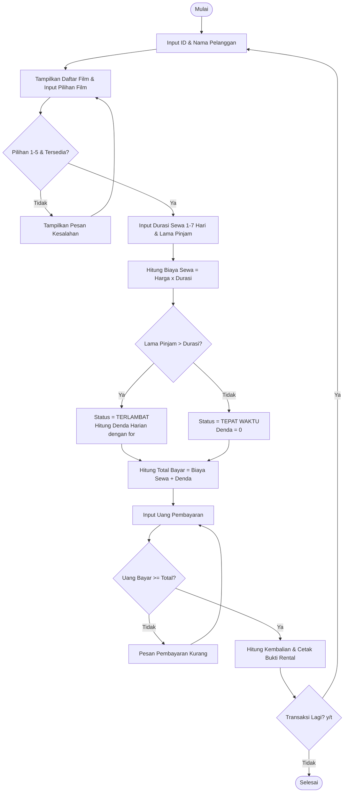

# LAPORAN MINI PROJECT PEMROGRAMAN DASAR (BAHASA C)

## HALAMAN SAMPUL

- **Judul Project:** Sistem Rental Film
- **Kelompok:** Kelompok 3
- **Anggota Kelompok:**
  1. NRP – Nama Mahasiswa 1 (Data Pelanggan & Film)
  2. NRP – Nama Mahasiswa 2 (Proses Sewa & Denda)
  3. NRP – Nama Mahasiswa 3 (Transaksi & Pengujian)
- **Mata Kuliah:** Pemrograman Dasar
- **Dosen Pengampu:** ........................................
- **Program Studi:** ........................................
- **Institusi:** ........................................
- **Tahun:** 2026

---

## BAB I — PENDAHULUAN

### 1.1 Latar Belakang
Proses penyewaan (rental) film yang dilakukan secara manual membutuhkan pencatatan data pelanggan, pengecekan ketersediaan judul film, serta perhitungan biaya sewa dan denda keterlambatan secara terstruktur. Pencatatan manual sering kali menimbulkan kesalahan dalam menentukan status pengembalian (tepat waktu atau terlambat) serta kekeliruan saat menghitung akumulasi denda harian. Oleh karena itu, dibuat sebuah program sederhana menggunakan bahasa C untuk membantu mengotomatisasi proses transaksi rental film mulai dari input pelanggan hingga pencetakan bukti rental.

### 1.2 Rumusan Masalah
1. Bagaimana membuat program Sistem Rental Film menggunakan bahasa C?
2. Bagaimana melakukan input data pelanggan serta validasi pilihan film menggunakan perulangan `do-while`?
3. Bagaimana menentukan biaya sewa, menghitung lama peminjaman, menghitung denda keterlambatan, dan menentukan status pengembalian menggunakan `if-else` dan perulangan?
4. Bagaimana menampilkan bukti rental, menampilkan status film, serta menguji peminjaman tepat waktu dan terlambat?

### 1.3 Tujuan
1. Membuat program Sistem Rental Film menggunakan bahasa C.
2. Menerapkan struktur percabangan `if` dan `if-else`.
3. Menerapkan struktur perulangan `while`, `do-while`, dan `for`.
4. Menerapkan validasi input dan perulangan proses transaksi.
5. Mengembangkan kemampuan bekerja sama dan membagi tugas dalam kelompok.

### 1.4 Batasan Masalah
- Program dibuat menggunakan bahasa C (`<stdio.h>`).
- Program **tidak menggunakan array data** untuk katalog film maupun daftar transaksi.
- Program **tidak menggunakan struct** atau konsep OOP.
- Program **tidak menggunakan pointer** (`*`).
- Struktur kontrol yang digunakan adalah `if`, `if-else`, `while`, `do-while`, dan `for`.
- Data hanya disimpan selama program berjalan (*in-memory*).

---

## BAB II — ANALISIS DAN PERANCANGAN

### 2.1 Deskripsi Sistem
Program dimulai dengan menampilkan menu utama, kemudian meminta pengguna memasukkan ID dan nama pelanggan. Selanjutnya program menampilkan daftar 5 judul film beserta harga sewa per hari dan status ketersediaannya (`Tersedia` / `Dipinjam`), lalu menerima dan memvalidasi pilihan film menggunakan `do-while`. Pengguna kemudian memasukkan durasi sewa yang disepakati (1–7 hari) serta lama peminjaman aktual saat pengembalian. Program menentukan harga film dan biaya sewa, mengecek apakah pengembalian tepat waktu atau terlambat menggunakan `if-else`, menghitung denda keterlambatan bertingkat menggunakan perulangan `for`, menerima pembayaran serta menghitung kembalian, lalu menampilkan bukti rental lengkap beserta status film terbaru.

### 2.2 Input – Proses – Output

| Input | Proses | Output |
| :--- | :--- | :--- |
| ID pelanggan | Validasi input pilihan film (`do-while`) | Data pelanggan (ID & Nama) |
| Nama pelanggan | Menentukan judul & harga film (`if-else`) | Judul film & harga sewa/hari |
| Pilihan nomor film (1–5) | Menghitung biaya sewa (`harga * durasi`) | Biaya sewa |
| Durasi sewa (1–7 hari) | Menghitung lama pinjam & keterlambatan (`if-else`) | Lama pinjam & hari terlambat |
| Lama peminjaman aktual | Menghitung denda keterlambatan (`for` & `if-else`) | Denda keterlambatan |
| Uang pembayaran | Menghitung total bayar & kembalian | Total pembayaran & kembalian |
| Pilihan ulang transaksi | Mengubah & menampilkan status ketersediaan film | Bukti rental & status film (`TEPAT WAKTU` / `TERLAMBAT`) |

### 2.3 Algoritma / Pseudocode

```text
Mulai
    Ulangi (do-while menu != 0)
        Tampilkan Menu Utama (1. Transaksi, 2. Daftar Film, 3. Pengujian, 0. Keluar)
        Input pilihan menu
        Jika menu == 1 Maka
            Ulangi (do-while ulangTransaksi == 'y')
                Input idPelanggan dan namaPelanggan
                Tampilkan pilihan 5 film beserta harga dan status

                Ulangi (do-while valid == 0)
                    Input pilihanFilm (1-5)
                    Jika pilihanFilm >= 1 dan pilihanFilm <= 5 dan film tersedia Maka
                        valid = 1
                    Jika tidak Maka
                        Tampilkan pesan kesalahan pilihan film
                        valid = 0
                Selama valid == 0

                Input durasiSewa (validasi 1-7 hari menggunakan do-while)
                Ubah status film terpilih menjadi Dipinjam
                Input lamaPinjam aktual (minimal 1 hari menggunakan do-while)

                Tentukan hargaPerHari berdasarkan pilihanFilm (if-else)
                biayaSewa = hargaPerHari * durasiSewa

                Jika lamaPinjam > durasiSewa Maka
                    hariTerlambat = lamaPinjam - durasiSewa
                    status = TERLAMBAT
                Jika tidak Maka
                    hariTerlambat = 0
                    status = TEPAT WAKTU

                denda = 0
                Untuk hariKe = 1 sampai hariTerlambat (for)
                    Jika hariKe <= 3 Maka
                        denda = denda + 5000
                    Jika tidak Maka
                        denda = denda + 10000

                totalBayar = biayaSewa + denda

                Ulangi (do-while uangBayar < totalBayar)
                    Input uangBayar
                    Jika uangBayar >= totalBayar Maka
                        kembalian = uangBayar - totalBayar
                    Jika tidak Maka
                        Tampilkan pesan pembayaran kurang

                Ubah status film terpilih menjadi Tersedia
                Tampilkan bukti rental dan status seluruh film
                Tanya apakah ingin melakukan transaksi lagi (y/t)
            Selama ulangTransaksi == 'y'
    Selama menu != 0
Selesai
```

### 2.4 Flowchart



---

## BAB III — IMPLEMENTASI PROGRAM

### 3.1 Lingkungan Pengembangan

| Komponen | Keterangan |
| :--- | :--- |
| **Bahasa pemrograman** | Bahasa C (Standard C99 / C11) |
| **Compiler/IDE** | GCC (MinGW) / Visual Studio Code |
| **Sistem operasi** | Microsoft Windows 10 / 11 |
| **Editor** | Visual Studio Code |

### 3.2 Struktur Program
1. **Bagian input pelanggan (`inputDataPelanggan`):** Menerima input ID pelanggan dan nama pelanggan.
2. **Bagian pemilihan & validasi film (`tampilkanDaftarFilm`, `inputDanValidasiFilm`):** Menampilkan tabel 5 film dan memvalidasi nomor pilihan film serta status ketersediaannya menggunakan `do-while`.
3. **Bagian input durasi & lama peminjaman (`inputDurasiDanLamaPinjam`):** Memvalidasi durasi sewa (1–7 hari), mengubah status film menjadi `Dipinjam`, dan menerima lama peminjaman aktual.
4. **Bagian perhitungan biaya & denda (`hitungSewaDanDenda`):** Menentukan harga sewa per hari, menghitung biaya sewa, mengecek status pengembalian dengan `if-else`, serta menghitung denda bertingkat menggunakan `for`.
5. **Bagian pembayaran (`prosesPembayaran`):** Memvalidasi kecukupan uang bayar, menghitung kembalian, dan mengembalikan status film menjadi `Tersedia`.
6. **Bagian output (`tampilkanBuktiRental`, `tampilkanStatusSemuaFilm`):** Mencetak struk bukti rental film dan daftar status film.
7. **Bagian pengujian & pengulangan (`pengujianOtomatis`, `main`):** Menguji skenario tepat waktu dan terlambat secara otomatis serta mengulang menu/transaksi dengan `do-while`.

### 3.3 Source Code
Source code lengkap terdapat pada file [`rental_film.c`](file:///c:/Users/Bayu%20Arga/Documents/Coding/Kuliah/Semester%201/Pemrograman/UTS/rental_film.c).

### 3.4 Penjelasan Source Code
- **`if`:** Digunakan untuk memeriksa kondisi validasi tunggal, seperti mengecek hasil pembacaan `scanf` dan hasil kelulusan pada pengujian otomatis.
- **`if-else`:** Digunakan untuk memilih judul dan harga film ke-1 s/d ke-5 (pengganti array/struct), menentukan status pengembalian (`TERLAMBAT` jika `lamaPinjam > durasiSewa`, atau `TEPAT WAKTU`), serta menentukan tarif denda harian (Rp 5.000 untuk hari ke-1..3, Rp 10.000 untuk hari ke-4 dst).
- **`while`:** Digunakan pada fungsi `bersihkanInput()` untuk membaca dan membuang sisa karakter di buffer sampai bertemu karakter newline (`'\n'`).
- **`do-while`:** Digunakan untuk mengulang menu utama, mengulang transaksi baru, serta memvalidasi input pilihan film, durasi sewa, lama pinjam, dan pembayaran agar diulang terus selama input belum valid.
- **`for`:** Digunakan untuk mengakumulasi denda keterlambatan dari hari ke-1 hingga `hariTerlambat`, mencetak garis pembatas, dan menampilkan status kelima film.
- **Variabel:** Menggunakan variabel bertipe `int` (pilihan, durasi, lama pinjam, status), `long` (harga, biaya sewa, denda, total, pembayaran, kembalian), dan `char` (ID, nama, pilihan ulang).
- **Operator:** Menggunakan operator aritmatika (`*`, `+`, `-`), operator relasional (`<`, `>`, `<=`, `>=`, `==`, `!=`), dan operator logika (`||`, `&&`).
- **Input/Output:** Menggunakan fungsi `printf()` untuk menampilkan menu, daftar film, dan bukti rental, serta `scanf()` dan `getchar()` untuk membaca masukan pengguna.

---

## BAB IV — PEMBAGIAN KONTRIBUSI

### 4.1 Mahasiswa 1 — Data Pelanggan & Film (Input & Validasi)
- **NRP:** ................................
- **Nama:** ................................
- **Tugas:**
  - Membuat input ID dan nama pelanggan.
  - Menampilkan daftar pilihan film beserta harga dan status.
  - Membuat input dan validasi pilihan film menggunakan `do-while`.
- **Kode yang dikerjakan:**
  - Fungsi `inputDataPelanggan()`
  - Fungsi `tampilkanDaftarFilm()`
  - Fungsi `inputDanValidasiFilm()`
- **Kontribusi pada integrasi program:**
  - Menyediakan data pelanggan dan nomor pilihan film yang sudah tervalidasi untuk diolah pada tahap perhitungan sewa.

### 4.2 Mahasiswa 2 — Proses Sewa & Denda (Proses & Perhitungan)
- **NRP:** ................................
- **Nama:** ................................
- **Tugas:**
  - Menentukan harga dan biaya sewa film.
  - Menghitung lama peminjaman dan jumlah hari keterlambatan.
  - Menghitung denda keterlambatan bertingkat menggunakan `for` dan `if-else`.
  - Menentukan status pengembalian (`TEPAT WAKTU` / `TERLAMBAT`) serta memproses pembayaran.
- **Kode yang dikerjakan:**
  - Fungsi `inputDurasiDanLamaPinjam()`
  - Fungsi `hitungSewaDanDenda()`
  - Fungsi `prosesPembayaran()`
- **Kontribusi pada integrasi program:**
  - Menghubungkan input pilihan film dari Mahasiswa 1 dengan logika perhitungan biaya, denda, dan status pengembalian yang akan ditampilkan oleh Mahasiswa 3.

### 4.3 Mahasiswa 3 — Transaksi & Pengujian (Output & Pengujian)
- **NRP:** ................................
- **Nama:** ................................
- **Tugas:**
  - Menampilkan bukti rental film lengkap beserta biaya dan denda.
  - Menampilkan status ketersediaan film (`Tersedia` / `Dipinjam`).
  - Menguji skenario peminjaman tepat waktu dan terlambat.
  - Mengintegrasikan seluruh fungsi ke dalam program utama (`main`).
- **Kode yang dikerjakan:**
  - Fungsi `tampilkanStatusSemuaFilm()`
  - Fungsi `tampilkanBuktiRental()`
  - Fungsi `jalankanTransaksi()`, `pengujianOtomatis()`, dan `main()`
- **Kontribusi pada integrasi program:**
  - Menyatukan seluruh modul Mahasiswa 1, 2, dan 3 ke dalam alur transaksi utuh dan menu utama interaktif.

---

## BAB V — PENGUJIAN PROGRAM

### 5.1 Skenario Pengujian

| No. | Skenario | Input | Hasil yang Diharapkan | Hasil Aktual | Status |
| :--: | :--- | :--- | :--- | :--- | :--: |
| 1 | Input valid (Tepat Waktu) | Film = 1 (Rp 8.000), Durasi = 3 hari, Lama = 3 hari | Biaya Rp 24.000, Denda Rp 0, Status `TEPAT WAKTU` | Biaya Rp 24.000, Denda Rp 0, Status `TEPAT WAKTU` | **Berhasil** |
| 2 | Pilihan film tidak valid | `pilihanFilm = 9` | Muncul pesan kesalahan & meminta input ulang | Muncul `[!] Error: Pilihan film tidak valid!` & minta ulang | **Berhasil** |
| 3 | Nilai batas & Terlambat | Film = 5 (Rp 9.000), Durasi = 2 hari, Lama = 7 hari | Telat 5 hari, Biaya Rp 18.000, Denda Rp 35.000, Total Rp 53.000, `TERLAMBAT` | Biaya Rp 18.000, Denda Rp 35.000, Total Rp 53.000, `TERLAMBAT` | **Berhasil** |
| 4 | Pembayaran kurang | Total = Rp 24.000, Bayar = Rp 10.000 | Pembayaran ditolak & diminta input ulang | Muncul `[!] Error: Uang pembayaran kurang!` & diulang | **Berhasil** |
| 5 | Pembayaran lebih | Total = Rp 24.000, Bayar = Rp 30.000 | Kembalian dihitung sebesar Rp 6.000 | Kembalian tampil `Rp 6000` pada bukti rental | **Berhasil** |

### 5.2 Bukti Pengujian

#### Pengujian 1 — Peminjaman Tepat Waktu
```text
[KASUS UJI 1] Peminjaman Tepat Waktu

================================================
               BUKTI RENTAL FILM
================================================
ID Pelanggan      : P001
Nama Pelanggan    : Budi Santoso
------------------------------------------------
Film Disewa       : Avengers: Endgame (F001)
Harga Sewa / Hari : Rp 8000
Durasi Sewa       : 3 hari
Lama Peminjaman   : 3 hari
Keterlambatan     : 0 hari
------------------------------------------------
Biaya Sewa        : Rp 24000
Denda Terlambat   : Rp 0
------------------------------------------------
TOTAL BAYAR       : Rp 24000
Uang Pembayaran   : Rp 30000
Kembalian         : Rp 6000
------------------------------------------------
Status Kembali    : TEPAT WAKTU
Status Film       : Tersedia (Sudah Dikembalikan)
================================================
       Terima kasih telah menyewa film!
================================================
>> HASIL UJI 1 (TEPAT WAKTU): BERHASIL / LULUS
```

#### Pengujian 2 — Peminjaman Terlambat
```text
[KASUS UJI 2] Peminjaman Terlambat

================================================
               BUKTI RENTAL FILM
================================================
ID Pelanggan      : P002
Nama Pelanggan    : Siti Aminah
------------------------------------------------
Film Disewa       : Interstellar (F005)
Harga Sewa / Hari : Rp 9000
Durasi Sewa       : 2 hari
Lama Peminjaman   : 7 hari
Keterlambatan     : 5 hari
------------------------------------------------
Biaya Sewa        : Rp 18000
Denda Terlambat   : Rp 35000
------------------------------------------------
TOTAL BAYAR       : Rp 53000
Uang Pembayaran   : Rp 60000
Kembalian         : Rp 7000
------------------------------------------------
Status Kembali    : TERLAMBAT
Status Film       : Tersedia (Sudah Dikembalikan)
================================================
       Terima kasih telah menyewa film!
================================================
>> HASIL UJI 2 (TERLAMBAT)  : BERHASIL / LULUS
```

---

## BAB VI — HASIL DAN PEMBAHASAN

### 6.1 Hasil Program
Program Sistem Rental Film berhasil dijalankan sesuai spesifikasi. Pengguna dapat memasukkan identitas pelanggan, melihat daftar film, memilih film dengan validasi `do-while`, menghitung biaya sewa dan denda keterlambatan secara otomatis, melakukan pembayaran, serta mencetak bukti rental dan menguji skenario tepat waktu maupun terlambat.

### 6.2 Penerapan Struktur Kontrol

| Struktur | Penggunaan dalam Program |
| :--- | :--- |
| `if` | Memvalidasi kondisi input tertentu dan memeriksa hasil pengujian otomatis |
| `if-else` | Menentukan judul/harga film (1–5), status pengembalian (`TEPAT WAKTU` / `TERLAMBAT`), dan tarif denda harian |
| `while` | Membersihkan sisa karakter pada buffer input (`getchar() != '\n'`) |
| `do-while` | Mengulang input pilihan film, durasi, pembayaran saat tidak valid, serta mengulang menu & transaksi |
| `for` | Menghitung akumulasi denda keterlambatan per hari dan mencetak garis/daftar status film |

### 6.3 Kendala dan Solusi

| Kendala | Solusi |
| :--- | :--- |
| Input pilihan film di luar nomor 1–5 atau sedang dipinjam | Menambahkan validasi kondisi di dalam perulangan `do-while` |
| Menyimpan katalog & status 5 film tanpa array maupun struct | Menggunakan variabel global `film1_tersedia` s/d `film5_tersedia` dan percabangan `if-else` |
| Uang pembayaran kurang dari total tagihan | Menambahkan kondisi `if (uangBayar < totalBayar)` di dalam `do-while` |
| Program berhenti setelah satu transaksi selesai | Menggunakan perulangan `do-while` pada menu utama dan transaksi |

---

## BAB VII — KESIMPULAN

### 7.1 Kesimpulan
Seluruh tujuan pembuatan mini project Sistem Rental Film telah tercapai. Program berhasil dibuat menggunakan bahasa C dengan menerapkan struktur kontrol `if`, `if-else`, `while`, `do-while`, dan `for` tanpa menggunakan array data, struct, maupun pointer, serta telah lolos pengujian untuk skenario peminjaman tepat waktu dan terlambat.

### 7.2 Saran Pengembangan
Pada tahap selanjutnya, program dapat dikembangkan untuk menangani lebih banyak katalog film dan data pelanggan menggunakan **array**. Selanjutnya atribut pelanggan, film, dan transaksi dapat dikelompokkan menggunakan **struct**, kemudian dilakukan manipulasi data antar-fungsi secara efisien menggunakan **pointer** serta penyimpanan ke dalam file.

---

## DAFTAR PUSTAKA
1. Kernighan, B. W., & Ritchie, D. M. (1988). *The C Programming Language* (2nd ed.). Prentice Hall.
2. Modul Praktikum Pemrograman Dasar Tahun 2026.
3. Dokumentasi C Standard Library (`<stdio.h>`) — https://en.cppreference.com/w/c
